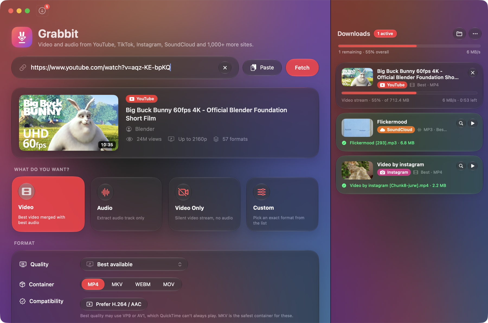
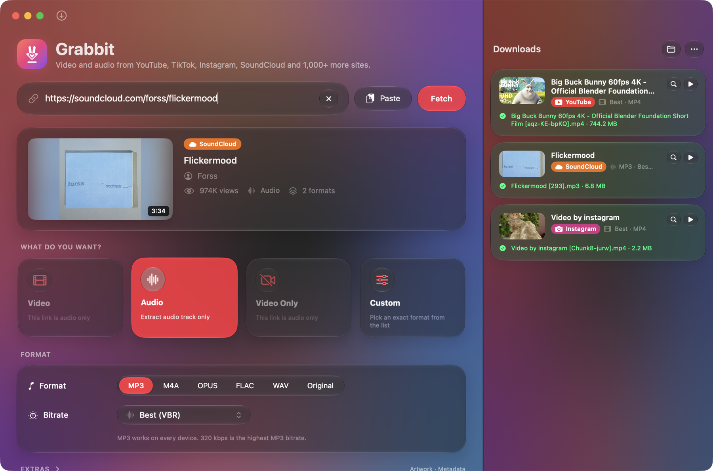
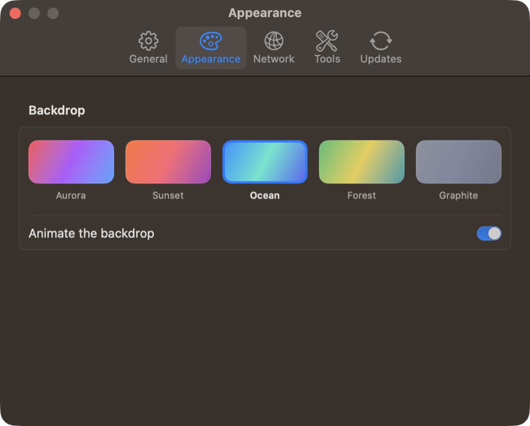
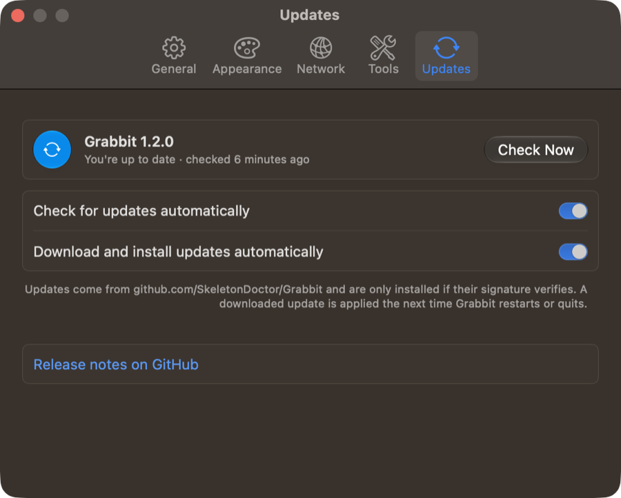

# Grabbit

A native macOS app that grabs video and audio from YouTube, TikTok, Instagram, SoundCloud and [more than a thousand other sites](https://github.com/yt-dlp/yt-dlp/blob/master/supportedsites.md) — paste a link, pick a format, go. Built in SwiftUI with a Liquid Glass interface on top of [yt-dlp](https://github.com/yt-dlp/yt-dlp), and it keeps itself up to date from this repository.



*Grabbit was called Grabbit until version 1.2. Existing installs update and rename themselves automatically.*

## Install

1. Download **Grabbit.zip** from the [latest release](https://github.com/SkeletonDoctor/Grabbit/releases/latest) and unzip it.
2. Move **Grabbit.app** to your **Applications** folder.
3. Open it. Grabbit isn't notarized by Apple, so the first launch is blocked: open **System Settings → Privacy & Security**, scroll down and click **Open Anyway**. (Or run `xattr -dr com.apple.quarantine /Applications/Grabbit.app` once in Terminal.)

Requires macOS 14 or later, Apple Silicon or Intel. If yt-dlp and ffmpeg aren't installed, the app offers to download them for you (checksum-verified, no Homebrew needed).

After that you never need to come back here: the app updates itself.

## Features

**Sites**
- Anything yt-dlp supports works: YouTube, TikTok, Instagram, SoundCloud, X, Facebook, Twitch, Vimeo, Reddit, Bandcamp, Mixcloud, Dailymotion, Bilibili, Kick, Rumble and many more
- Every download is labelled with the site it came from, and a copied link from a known site is offered as soon as you switch to the app
- Audio-only sources such as SoundCloud and Bandcamp switch to Audio automatically
- Portrait clips and square artwork are shown whole in the preview
- When a site wants you signed in (Instagram often does), the error says so and points to **Settings → Network → Use cookies from**

**Downloading**
- Paste or drag in a link and it fetches the title, thumbnail, duration and available resolutions
- **Video** (best video + best audio, merged), **Audio only**, **Video only**, or **Custom** (pick any exact stream from the format table)
- Quality from 240p to 8K · MP4, MKV, WebM, MOV · "Prefer H.264/AAC" for QuickTime, iPhone and Final Cut
- Audio as MP3, M4A, Opus, FLAC, WAV or the original stream, 128–320 kbps or best VBR
- Extras: cover art, metadata, chapters, subtitles (including auto-generated), SponsorBlock removal (YouTube), download only a time range
- Whole playlists into their own folder with numbered files
- Batch mode: paste several links, one per line, and queue them all at once
- Browser cookies for age-restricted or members-only videos, optional speed limit
- Estimated file size before you download, and a button that shows the exact yt-dlp command

**Queue**
- Live progress, speed and ETA per download and for the whole queue
- Cancel, retry, reveal in Finder, per-download log; drag finished files straight out of the list
- History survives a relaunch, and interrupted downloads resume with Retry

**In the background**
- Menu bar item with live progress and one-click download of a copied link
- Close the window and downloads keep running; the Mac stays awake until they finish
- Notifications and a Dock badge when downloads complete
- Links queued without a preview get their title and thumbnail filled in automatically
- yt-dlp is kept current automatically, whether the app installed it or Homebrew did

**Look**
- Liquid Glass throughout on macOS 26+ (material fallback on macOS 14–15)
- Five backdrops — Aurora, Sunset, Ocean, Forest, Graphite — that pause when the window is in the background

| Audio-only link | Appearance | Updates |
| --- | --- | --- |
|  |  |  |

## Automatic updates

Grabbit checks this repository's [releases](https://github.com/SkeletonDoctor/Grabbit/releases) when it starts and once a day after that. When a newer version exists it downloads it in the background, verifies it, and installs it the next time the app restarts or quits — a banner offers **Restart Now** if you'd rather not wait.

Every release archive is signed with an Ed25519 key, and the app refuses anything whose signature doesn't match the public key built into it, so an update can only come from the maintainer. Both automatic checking and automatic installing can be turned off in **Settings → Updates**; **Grabbit → Check for Updates…** checks on demand.

The app must live in a folder you can write to (such as Applications) for updates to install.

## Keyboard shortcuts

| | |
| --- | --- |
| ⌘↩ | Download |
| ⇧⌘V | Paste and fetch |
| ⌘J | Show or hide the queue |
| ⌘, | Settings |

## Build from source

Requires full Xcode (for the SwiftUI macros).

```
./Scripts/build_app.sh
cp -R build/Grabbit.app /Applications/
```

`swift run` works for development, and `open Package.swift` opens the project in Xcode.

### Publishing a release

1. Bump the number in `VERSION`, commit and push.
2. Run `./Scripts/release.sh` (optionally with release notes as an argument).

The script builds a universal app, zips and signs it, and creates the GitHub release; installed copies pick it up within a day. It needs the [GitHub CLI](https://cli.github.com) and the signing key at `~/.config/ytdown/update_signing_key` (the folder keeps the app's old name).

If you fork this, generate your own key with `swift Scripts/sign_update.swift keygen` and put the printed public key and your repository name at the top of `Sources/Grabbit/Updater.swift`.

## A note on use

Grabbit is a front-end for yt-dlp and isn't affiliated with any of the sites it works with. Download only what you have the right to download, and respect the terms of the sites you use it with.
